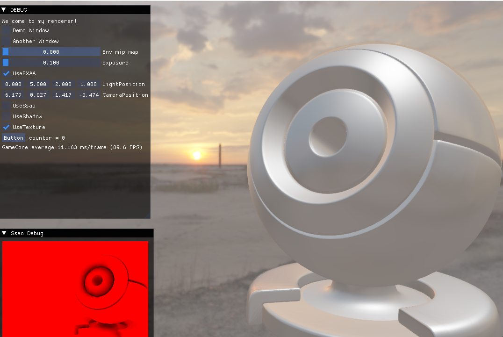
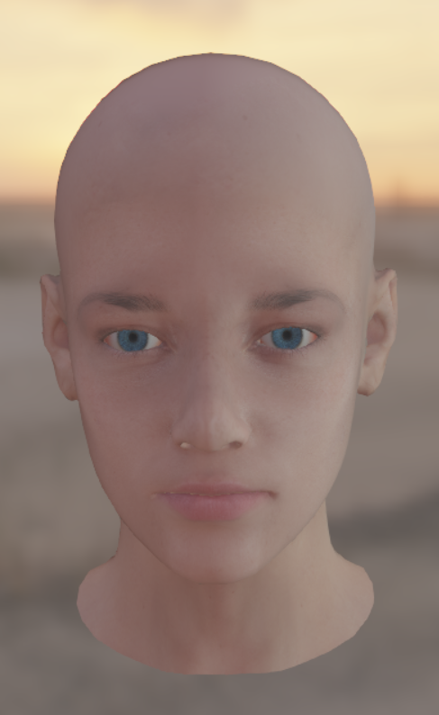

# AtomEngine

Windows / Direct3D 12 renderer with a standalone editor and a PBR sample.

## Build and run

Install Visual Studio C++ tools (v143), the Windows SDK, and PowerShell 7. Initialize the repository's dependency submodules, then run from the repository root:

```powershell
git submodule update --init --recursive
pwsh -File scripts/Build-Pbr.ps1 -Target All -Configuration Debug -SmokeTest
```

The script builds only PBR and AtomEditor and runs each for 60 frames, including four view sizes, odd-size SSAO, TAA toggling/history reset, a real main-window resize, and resource-isolation checks. It also checks asynchronous model loading, shared asset residency, malformed/missing-file diagnostics, and cancellation before/after GPU submission. Five frame-scheduler checks validate fenced resource retention, three queued slots, reuse, and drain; rendering submits without waiting for every frame to finish. Debug smoke tests require D3D12 validation and fail on validation errors, device removal, failed view/asset/frame checks, premature exit, or timeout. Logs are saved under `bin-int/build-logs`. Both applications also require 12 cache checks for budgets, LRU eviction, request/frame ownership, textured-upload cancellation and descriptor reuse. Smoke runs do not save ImGui layout preferences. Windows Graphics Tools must be available for Debug validation.

```powershell
# Interactive editor
& .\bin\Debug-windows-x86_64\AtomEditor\AtomEditor.exe
# Standalone rendering sample
& .\bin\Debug-windows-x86_64\PBR\PBR.exe
# Release build and basic runtime check (without the Debug validation layer)
pwsh -File scripts/Build-Pbr.ps1 -Target All -Configuration Release -SmokeTest
```

The editor provides scene hierarchy, transforms, asynchronous model import, asynchronous scene opening with progress/cancellation, atomic scene save, and undo/redo. Failed or cancelled scene loads preserve the active document and history. Use Ctrl+O to open, Ctrl+S to save, Ctrl+Shift+S to save as, and Ctrl+Z/Ctrl+Y to undo/redo. Its view owns its render targets, camera, and temporal history and renders at the panel's pixel dimensions; scene edits reset TAA history. Editor smoke runs also require all 13 document and command checks to pass. See [architecture and migration stages](docs/architecture/editor-and-renderer.md) for the implemented boundaries and remaining work.

The Content Browser shows model cache residency and lets you set CPU/GPU soft budgets (default: 512/1024 MiB). Unused models are evicted by recent use; active requests, scene/undo references and pending GPU frames retain their resources. Owned model textures release with their model and recycle both SRV descriptor slots. The budgets cover retained model data and committed model geometry/images, and can be exceeded by active assets.

The shared PBR renderer lives in Atom core. Multiple views reuse one set of pipelines, environment/BRDF resources and skybox residency; each view has independent attachments, camera, descriptors and temporal state. Smoke runs render two complete views for all 60 frames and validate independent resize/history and renderer recreation.

#### Some features of AtomEngine



> pbr


> skin shading

#### FEATURE
- [x] Physicis Based Rendering
- [x] Image Based Lighting(Spilt Sum Approximate)
- [x] pecentage Closer Soft Shadow Mapping
- [x] Screen Space Ambient Occlusion
- [x] Fast Approximate Anti Alising
- [x] Pre-integral Sub-Surface Scatter
- [ ] Async compute scheduling (the PBR frame currently uses one direct queue)
- [x] Editor scene workflow (hierarchy, inspector, import, save/load, undo/redo)
- [ ] Deffer Rendering
- [x] Bloom (screen-space bright extraction and blur)
- [ ] Depth of Field
- [ ] Motion Blur
- [ ] MultiThread
- [ ] SSSS

#### Refrence

MiniEngine

DiligentEngine

d3d12book
